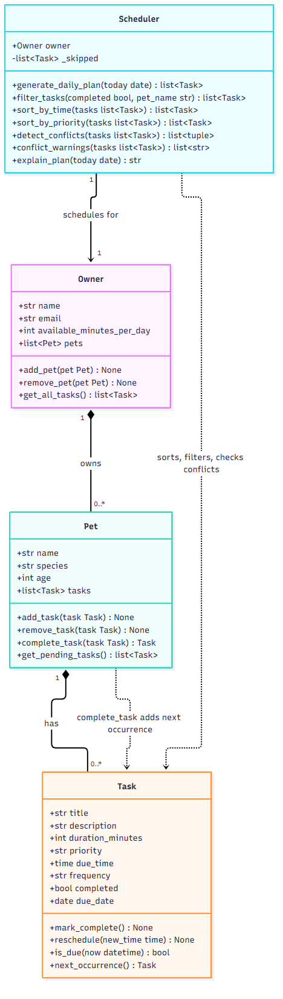

# PawPal+

PawPal+ is a pet-care planner. A pet owner enters their pets and the care tasks each one needs (walks, feeding, medication, grooming), and PawPal+ builds a daily plan that fits the owner's available time, orders it by time of day, warns about overlapping tasks, and explains its choices. It has a Streamlit web app and a command-line demo that share the same backend in `pawpal_system.py`.

## Features

| Feature | What it does | Where it lives |
|---------|--------------|----------------|
| Owner and multiple pets | One owner (name, email, daily minutes available) with any number of pets; duplicates and unknown pets are ignored safely | `Owner.add_pet`, `Owner.remove_pet`, `Owner.get_all_tasks` |
| Pet-care tasks | Title, description, duration, priority (low/medium/high), optional time, frequency (daily/weekly/once) | `Task`, `Pet.add_task`, `Pet.remove_task`, `Pet.get_pending_tasks` |
| Chronological sorting | Orders tasks by time of day; tasks with no time go last; the input list is not changed | `Scheduler.sort_by_time` (and `sort_by_priority`) |
| Filtering | By pet name (case-insensitive), by completion status, or both, across all pets | `Scheduler.filter_tasks` |
| Daily plan | Skips completed tasks, picks by priority within the owner's available minutes, shows the result in time order, and explains what was skipped | `Scheduler.generate_daily_plan`, `Scheduler.explain_plan` |
| Conflict warnings | Finds tasks whose time ranges overlap (same pet or different pets) and describes them; it only warns and never blocks | `Scheduler.detect_conflicts`, `Scheduler.conflict_warnings` |
| Recurring tasks | Completing a daily or weekly task adds the next occurrence (+1 or +7 days); one-time tasks don't repeat | `Pet.complete_task`, `Task.next_occurrence` |
| Streamlit UI | Add pets and tasks, filter and complete tasks, generate and read the schedule | `app.py` |
| CLI demo | Walks through sorting, filtering, conflicts, recurrence and the plan | `main.py` |
| Automated tests | 35 pytest tests with fixed dates | `tests/test_pawpal.py` |

## Setup (Windows)

```powershell
git clone https://github.com/pavanbyte007-ai/ai110-module2show-pawpal-starter.git
cd ai110-module2show-pawpal-starter
python -m venv .venv
.venv\Scripts\activate
pip install -r requirements.txt
```

If PowerShell refuses to run the activate script, run `Set-ExecutionPolicy -Scope Process RemoteSigned` once in that window and activate again. On macOS or Linux use `source .venv/bin/activate` instead.

## Usage

```bash
streamlit run app.py     # web app, opens at http://localhost:8501
python main.py           # command-line demo
python -m pytest         # automated tests
```

## Demo Walkthrough

### Main UI features

In the Streamlit app you can:

- **Set up the owner:** name, email and how many minutes per day are available for pet care.
- **Add pets:** name, species and age. Empty and duplicate names are rejected with a message.
- **Schedule tasks:** pick a pet, then enter a title, an optional description, frequency, duration, priority and (optionally) a time. A task with the same title and time for the same pet is rejected as a duplicate.
- **Review tasks:** filter by pet and by status (all, pending, completed). Tasks are listed in time order, and each one has **Complete** and **Remove** buttons.
- **See conflicts:** overlapping pending tasks are listed in a warning with both tasks, their pets and their time ranges, plus a suggestion to reschedule one of them. You can still create them.
- **Build the schedule:** "Generate schedule" shows today's plan as a table (time, pet, task, duration, priority, status) with a summary of minutes used, a "Why this plan?" explanation, and a list of completed tasks.

### Example workflow

1. Add a pet: enter "Buddy", choose "dog", and click **Add pet**.
2. Schedule a task: choose Buddy, enter "Morning walk", set the duration to 30, priority to high, time to 07:30, frequency to daily, and click **Add task**.
3. Add a second task, for example "Dinner" at 18:00, and another pet if you like.
4. Click **Generate schedule** to see today's plan in time order.
5. Click **Complete** on "Morning walk". It leaves today's plan, appears under completed tasks, and a new "Morning walk" dated tomorrow is created because it is a daily task.

### Scheduler behavior

- **Sorting:** the plan and the task lists are ordered by time of day. Tasks without a time appear last.
- **Choosing tasks:** completed tasks and tasks dated in the future are left out. The rest are taken high priority first (ties go to the earlier time) as long as they fit in the owner's available minutes. A task that doesn't fit is skipped and listed in the explanation, but a shorter task later in the order can still fit.
- **Conflict warnings:** a task occupies the range from its start time to start time plus duration. Two tasks conflict if their ranges overlap. A task that starts exactly when another ends is fine. Tasks with no time are ignored.
- **Filtering:** by pet and/or completion status, across every pet the owner has.
- **Recurring tasks:** completing a daily task creates a copy dated one day later, and a weekly task seven days later. The original stays completed, the copy starts incomplete, and completing the same task twice does not create a second copy. One-time tasks do not repeat.

### CLI demonstration

Running `python main.py` prints this (actual output):

```
============================================================
PawPal+ demo for Jordan (Buddy, Whiskers)
============================================================

1. Tasks as entered (out of order)
------------------------------------------------------------
18:00    Buddy    Dinner (10 min, high, daily, pending)
07:30    Buddy    Morning walk (30 min, high, daily, pending)
15:00    Buddy    Bath (45 min, low, weekly, pending)
17:50    Buddy    Vet visit (40 min, medium, once, pending)
17:45    Whiskers Playtime (20 min, medium, daily, pending)
Anytime  Whiskers Brush fur (15 min, low, weekly, pending)
08:00    Whiskers Medication (5 min, high, daily, pending)

2. Sorted by time (missing times last)
------------------------------------------------------------
07:30    Buddy    Morning walk (30 min, high, daily, pending)
08:00    Whiskers Medication (5 min, high, daily, pending)
15:00    Buddy    Bath (45 min, low, weekly, pending)
17:45    Whiskers Playtime (20 min, medium, daily, pending)
17:50    Buddy    Vet visit (40 min, medium, once, pending)
18:00    Buddy    Dinner (10 min, high, daily, pending)
Anytime  Whiskers Brush fur (15 min, low, weekly, pending)

3a. Filter: Whiskers' tasks
------------------------------------------------------------
17:45    Whiskers Playtime (20 min, medium, daily, pending)
Anytime  Whiskers Brush fur (15 min, low, weekly, pending)
08:00    Whiskers Medication (5 min, high, daily, pending)

3b. Filter: completed tasks (all pets)
------------------------------------------------------------
07:30    Buddy    Morning walk (30 min, high, daily, done)

3c. Filter: Buddy's pending tasks
------------------------------------------------------------
18:00    Buddy    Dinner (10 min, high, daily, pending)
15:00    Buddy    Bath (45 min, low, weekly, pending)
17:50    Buddy    Vet visit (40 min, medium, once, pending)

4. Conflict detection (pending tasks, all pets)
------------------------------------------------------------
WARNING: Playtime (Whiskers, 17:45-18:05) overlaps Vet visit (Buddy, 17:50-18:30)
WARNING: Playtime (Whiskers, 17:45-18:05) overlaps Dinner (Buddy, 18:00-18:10)
WARNING: Vet visit (Buddy, 17:50-18:30) overlaps Dinner (Buddy, 18:00-18:10)

5. Recurring tasks
------------------------------------------------------------
Completed 'Dinner' (daily) -> next one created for 2026-10-27
Completing it again adds nothing new: None
Completed 'Vet visit' (once) -> next one created: None

6. Today's plan (future repeats and completed tasks left out)
------------------------------------------------------------
08:00    Whiskers Medication (5 min, high, daily, pending)
15:00    Buddy    Bath (45 min, low, weekly, pending)
17:45    Whiskers Playtime (20 min, medium, daily, pending)
Anytime  Whiskers Brush fur (15 min, low, weekly, pending)

7. Plan explanation
------------------------------------------------------------
Daily plan for Jordan: 85 of 90 available minutes used.
Tasks are chosen by priority (high first), then earliest time, and shown in time order.
  08:00 - Medication for Whiskers (5 min) [priority: high]
  15:00 - Bath for Buddy (45 min) [priority: low]
  17:45 - Playtime for Whiskers (20 min) [priority: medium]
  any time - Brush fur for Whiskers (15 min) [priority: low]

8. Empty owner
------------------------------------------------------------
No pending tasks, so there is nothing to plan today.
```

## Implementation Summary

**Classes** (in `pawpal_system.py`):

- **Task**: one care activity (title, description, duration, priority, due time, frequency, completed flag, optional due date). It can mark itself complete, be rescheduled, report whether it is due, and build its next occurrence.
- **Pet**: a pet's name, species and age, plus its own list of tasks. It adds, removes and completes tasks (ignoring duplicates and unknown tasks) and returns the pending ones.
- **Owner**: the owner's name, email, daily time budget (`available_minutes_per_day`) and a list of pets. `get_all_tasks()` combines the tasks of every pet.
- **Scheduler**: plans for one owner. It never reads a single pet's list; it always calls `owner.get_all_tasks()` (or `filter_tasks`, which walks all pets), so every pet is included.

**Architecture:** an Owner has many Pets, and a Pet has many Tasks. The Scheduler holds one Owner and works with that owner's Tasks. The data classes hold information and the Scheduler holds the planning decisions. The Streamlit app keeps one Owner and one Scheduler in `st.session_state`, so pets, tasks and completion status persist across reruns.

## 📐 Final UML

The final class diagram matches the code in `pawpal_system.py`. Source: [`diagrams/uml_final.mmd`](diagrams/uml_final.mmd) (the original draft is still in `diagrams/uml.mmd`).



## 📐 Smarter Scheduling

All of these live in `pawpal_system.py`, are covered by `tests/test_pawpal.py`, and are shown by `python main.py`.

- **Sorting:** `Scheduler.sort_by_time(tasks)` returns a new list ordered by `due_time` using `sorted()` with a key. Tasks with no `due_time` go last, and the original list is not changed. `Scheduler.sort_by_priority(tasks)` orders high, then medium, then low (unknown values last), with ties broken by time.
- **Filtering:** `Scheduler.filter_tasks(completed=None, pet_name=None)` returns tasks from all of the owner's pets, optionally limited by completion status and/or pet name (case-insensitive). `Pet.get_pending_tasks()` does the same for a single pet.
- **Conflict detection:** `Scheduler.detect_conflicts(tasks)` returns pairs of tasks whose time ranges overlap. A task occupies [`due_time`, `due_time` + `duration_minutes`), so a task that starts exactly when another ends is not a conflict. Tasks with no time, or a zero or negative duration, are ignored, and tasks on different `due_date`s never conflict. `Scheduler.conflict_warnings()` turns the pairs into readable messages naming each task, its pet and its time range. Conflicts are only reported; the scheduler never blocks or moves tasks.
- **Recurring tasks:** `Pet.complete_task(task)` marks a task complete and, for `daily` or `weekly` tasks, adds the next occurrence made by `Task.next_occurrence()`. The new `due_date` is the old `due_date` plus 1 day (daily) or 7 days (weekly), using `timedelta`. The copy keeps the title, description, duration, priority, time and frequency, and starts incomplete. Completing the same task twice, or when an identical pending copy already exists, adds nothing. `once` tasks do not repeat. Calling `Task.mark_complete()` directly only marks the task done and does not create a repeat.

**Limitations:** a task with no `due_date` is treated as "today", so its repeat is dated from today's date. `generate_daily_plan()` plans one day and leaves out tasks dated in the future. Tasks without a time are never reported as conflicts. Conflict detection compares every pair of tasks (O(n²)), which is fine for a typical day's task list.

| Feature | Method(s) | Notes |
|---------|-----------|-------|
| Task sorting | `Scheduler.sort_by_time`, `sort_by_priority` | `sorted()` with a key; tasks with no time go last; input list is not modified |
| Filtering | `Scheduler.filter_tasks(completed, pet_name)` | Works across all pets; either filter can be omitted |
| Conflict handling | `Scheduler.detect_conflicts`, `conflict_warnings` | Overlapping ranges on the same date; touching tasks and tasks with no time are ignored |
| Recurring tasks | `Task.next_occurrence`, `Pet.complete_task` | Completing a daily/weekly task adds the next copy with a future `due_date`; "once" tasks don't repeat |

## 🧪 Testing PawPal+

Run the full test suite from the project folder:

```bash
python -m pytest
```

Add `-v` to list every test. The suite is in `tests/test_pawpal.py` (35 tests). It uses fixed dates, so results do not depend on the clock. It covers:

- **Task completion and management:** `mark_complete()`, adding and removing tasks, duplicate and unknown items, pending tasks, and an owner and scheduler seeing tasks from several pets (including a pet with no tasks).
- **Chronological sorting:** shuffled times come out in order, tasks with no time go last, equal times keep their input order, and an empty list is fine. Priority sorting is also tested.
- **Recurring tasks:** daily (+1 day) and weekly (+7 days) repeats, month and year rollover, details preserved, the original stays complete while the copy starts incomplete, one-time tasks don't repeat, repeated completion doesn't duplicate, and future repeats stay out of today's plan.
- **Conflict detection:** same start time, partial overlap, touching and distant tasks, conflicts across pets and within one pet, plus empty lists, missing times, bad durations and different dates. The warning messages are also checked.
- **Filtering:** by completion status, by pet name (case-insensitive), by both, and cases where nothing matches.
- **Daily plan:** completed tasks are skipped, the time budget is respected, and the explanation lists planned tasks, skipped tasks and conflicts.

Actual output of the last run:

```
============================= test session starts =============================
platform win32 -- Python 3.12.2, pytest-9.1.1, pluggy-1.6.0
rootdir: E:\A110 Project 2\ai110-module2show-pawpal-starter
plugins: anyio-4.13.0
collected 35 items

tests\test_pawpal.py ...................................                 [100%]

============================= 35 passed in 0.05s ==============================
```

### Confidence Level: ★★★★☆ (4 of 5)

All 35 tests pass, including edge cases for empty input, missing times and repeated completion. I did not measure code coverage. Remaining limitations:

- The Streamlit UI (`app.py`) has no automated tests. It was only checked with a scripted run and by hand.
- A recurring task with no `due_date` repeats from the real current date, and that path is not tested with a fixed date.
- Tasks with no time are never reported as conflicts.
- The planner is greedy, so it can leave available minutes unused when a better combination of tasks exists.
